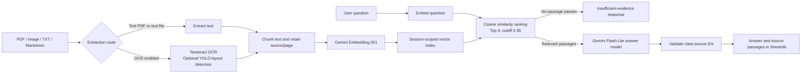

# RAG Knowledge Assistant

A Streamlit app for asking questions about approved documents. It extracts document text, optionally OCRs scanned PDF pages, retrieves relevant passages, and generates answers with source and page citations. If the evidence is not relevant enough, it returns an insufficient-evidence response instead of calling the answer model.

[](https://youtu.be/uo75KwcNgxg)

Watch the [project walkthrough on YouTube](https://youtu.be/uo75KwcNgxg).

## Quick start

1. Install Python 3.11 and create a Gemini API key at [Google AI Studio](https://aistudio.google.com/app/apikey).
2. Follow the [Windows setup instructions](#run-locally-on-windows) below and add the key to `.streamlit/secrets.toml`.
3. Run the app, upload [`data/sample_company_handbook.md`](data/sample_company_handbook.md), and ask one of the answerable questions in [`evaluation/qa_set.json`](evaluation/qa_set.json).
4. Try an out-of-scope question from the same set to see the insufficient-evidence behavior.

## Project files

| Path | Purpose |
| --- | --- |
| `app.py` | Streamlit interface, document review, indexing, chat, and source display |
| `ingestion.py`, `ocr_layout.py` | Text extraction and optional OCR for scanned PDFs and photos |
| `chunking.py` | Split extracted text into overlapping passages while retaining source metadata |
| `embeddings.py`, `vector_store.py` | Gemini embeddings and session-scoped vector storage |
| `retrieval.py` | Similarity ranking and relevance cutoff |
| `generation.py` | Evidence-grounded Gemini answers and citation ID checks |
| `data/sample_company_handbook.md` | Synthetic sample knowledge base for trying the app |
| `evaluation/qa_set.json` | Labeled example questions with expected answers, sources, and scope labels |
| `docs/architecture.mmd` | Mermaid architecture diagram source |
| `tests/` | Offline unit tests for core behavior |

## Architecture



The editable diagram is in [`docs/architecture.mmd`](docs/architecture.mmd). The 0.35 setting is a retrieval threshold, not a confidence percentage. The app sends the full text of retrieved passages that pass the cutoff to the answer model.

## Screenshots

The thumbnail below links to the [YouTube walkthrough](https://youtu.be/uo75KwcNgxg), which shows the running app, document upload, and answer flow. Screenshots of the current UI can be added under `docs/screenshots/`; use only the synthetic sample or public documents, and make sure API keys and private document contents are not visible.

[](https://youtu.be/uo75KwcNgxg)

## Features

- Upload PDF, JPG, JPEG, PNG, TIFF, BMP, WebP, TXT, and Markdown files (up to 10 MB each).
- Inspect extracted text before indexing it.
- Apply OCR to PDF pages and photos with the layout model plus Tesseract or Tesseract alone. Photos are not indexed unless OCR is enabled and succeeds.
- Chunk and embed documents with Gemini, then retrieve passages using cosine similarity.
- Generate evidence-grounded answers, validate citation IDs, and show the cited passages.
- Keep the active knowledge base in the current Streamlit session; remove individual documents or clear the session index.

## Run locally on Windows

Requirements: Python 3.11 and a Gemini API key. The app can start without a key, but document embedding and question answering need it.

```powershell
py -3.11 -m venv .venv
.\.venv\Scripts\Activate.ps1
python -m pip install --upgrade pip
python -m pip install -r requirements.txt
if (-not (Test-Path .streamlit/secrets.toml)) { Copy-Item .streamlit/secrets.toml.example .streamlit/secrets.toml }
notepad .streamlit/secrets.toml
python -m streamlit run app.py
```

In `.streamlit/secrets.toml`, replace the placeholder with your key:

```toml
GEMINI_API_KEY = "your-gemini-api-key"
GEMINI_MODEL = "gemini-3.5-flash-lite"
GEMINI_FALLBACK_MODEL = "gemini-3.1-flash-lite"
```

The app also accepts `GOOGLE_API_KEY`. A key in this project's `.streamlit/secrets.toml` takes precedence over machine environment variables, so a stale Windows `GOOGLE_API_KEY` will not override the project key. The app prefers `GEMINI_API_KEY` if both names appear in the project secrets file. Answer generation uses Gemini 3.5 Flash-Lite; it tries Gemini 3.1 Flash-Lite only for immediate model errors. Invalid-key, quota, and timeout errors do not trigger another model request.

Create or copy a Gemini API key from [Google AI Studio's API keys page](https://aistudio.google.com/app/apikey). If Google reports `API_KEY_INVALID`, replace the value in `.streamlit/secrets.toml` with the active Gemini API key (without extra spaces or quotation marks inside the value), save, and restart Streamlit. Keep the key private; never commit the real secrets file. You can change the two model names there if you want to try a different supported model.

Keep the real secrets file private. It is excluded by `.gitignore`. Streamlit prints the local app URL, usually `http://localhost:8501`. Stop the app with **Ctrl+C** in the terminal.

### If PowerShell blocks environment activation

```powershell
py -3.11 -m venv .venv
.\.venv\Scripts\python.exe -m pip install --upgrade pip
.\.venv\Scripts\python.exe -m pip install -r requirements.txt
if (-not (Test-Path .streamlit/secrets.toml)) { Copy-Item .streamlit/secrets.toml.example .streamlit/secrets.toml }
notepad .streamlit/secrets.toml
.\.venv\Scripts\python.exe -m streamlit run app.py
```

## Use the app

1. Choose one or more PDFs, photos, TXT, or Markdown files in the sidebar.
2. Photos require OCR to be indexed. Enable **Use OCR for PDFs and photos** and select the layout-model method or Tesseract-only mode. The same option applies OCR to PDFs; leave it off to use normal PDF text extraction. The review panel also keeps a manual OCR button for individual PDFs.
3. The app automatically creates embeddings after extraction and OCR review are complete. Fixed defaults are 500 characters per chunk, 80 characters of overlap, four retrieved passages, and a 0.35 minimum cosine-similarity cutoff. These are practical starting values for a small demo; they are not universally optimal.
4. Ask a question in the chat box. Read the answer and expand its source citations to inspect the supporting passages. Use the retrieval panel to inspect ranked passages, including when the app abstains.
5. Remove a file from the uploader to remove it from the active session index. Use **Clear chat** to reset the conversation.

The fixed minimum relevance score is a retrieval cutoff, not a probability of correctness. A citation proves that the model referenced a retrieved passage; it does not prove that the passage supports every claim. Check the displayed passage when accuracy matters.

## Sample knowledge base and evaluation questions

The sample handbook is synthetic and exists only for demonstration. Upload it into the app to try the included questions. The JSON file labels each example as `answerable` or `out_of_scope`; answerable entries include an expected answer and source, while out-of-scope entries describe the expected fallback. This is a small starter set for manual checks, not a benchmark and not a reported evaluation result.

To review it manually, ask each question in the app and compare the response and citations with the expected answer and source in `evaluation/qa_set.json`. Check whether unsupported questions are declined. The app does not automatically run this file as an evaluation suite.

## Optional OCR setup

OCR is optional for PDFs and required for photos. It is not used for TXT or Markdown files. To enable it locally:

1. Install the extra Python packages:

   ```powershell
   python -m pip install -r requirements-ocr.txt
   ```

2. Install Tesseract separately and make sure the English language data (`eng`) is available. The app checks the standard Windows location under `%ProgramFiles%\Tesseract-OCR`; otherwise set `TESSERACT_CMD` to the full executable path in the PowerShell window used to start Streamlit.
3. Keep the document-layout checkpoint at `best_model/doclaynet_yolov8s_baseline.pt`.

The layout model detects text regions; Tesseract recognizes the characters. Tesseract-only mode is supported and does not remove or replace the optional layout model. OCR is an alternate extraction route, not a guarantee of correct transcription. Verify names, numbers, tables, and reading order before using OCR output as evidence. The default Streamlit Community Cloud installation does not install these optional packages or the Tesseract executable.

## Privacy and deployment limits

- Document extraction and the active index are kept in the app session; the app does not save uploaded originals or the index to a persistent database.
- When indexing, document chunks are sent to Gemini for embeddings. Questions and retrieved passages are sent to Gemini when generating answers. Only process documents you are authorized to send to that service.
- A hosted app uses the Gemini key configured by its owner. Visitors share its API quota. Do not publish a hosted app with an unrestricted key.
- A hosted app does not provide accounts, authentication, or durable storage. This is a portfolio/demo app, not a multi-tenant production service.

### Deploy to Streamlit Community Cloud

1. Create and push a GitHub repository containing this project. Do not include `.streamlit/secrets.toml`, virtual environments, or private documents.
2. In Streamlit Community Cloud, create an app from the repository, choose your branch, and set `app.py` as the main file.
3. Select Python 3.11 in the advanced settings.
4. Add this to the app's **Secrets** setting, replacing the placeholder with your Gemini API key:

   ```toml
   GEMINI_API_KEY = "your-gemini-api-key"
   ```

5. Deploy, upload an approved document, then test one question it answers and one it does not answer.

### License note

The optional OCR path uses Ultralytics and includes a YOLO checkpoint. Ultralytics' current guidance says its software and trained models are AGPL-3.0 by default. Record the checkpoint's source and license, then choose a project license consistent with all included code and model terms before publishing. See the [Ultralytics license guidance](https://www.ultralytics.com/license).

## Run offline tests

After installing the core requirements:

```powershell
python -m unittest discover -s tests -v
```

The tests cover chunk metadata and overlap validation, retrieval ranking, citation validation, evaluation metrics, and SQLite index behavior.
